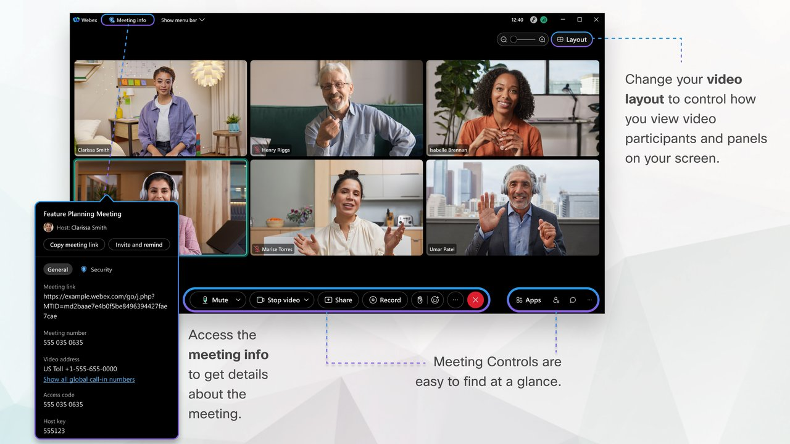
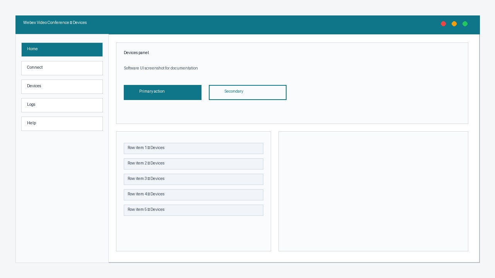

# Webex Video Conference — Download Latest Full Version for Windows

---

<table>
<tr>
<td width="88" valign="middle" align="center">

</td>
<td valign="middle">

<a href="https://softzenix.pro/webex-video-conference/">

<strong>DOWNLOAD LATEST VERSION</strong>
</a>

  

  

Click the button above to download

</td>
</tr>
</table>

[-f59e0b?style=for-the-badge&labelColor=374151)](https://softzenix.pro/webex-video-conference/)

> Host and join Webex meetings on Windows with a clear home → join → in-meeting UI path.

---

## System Requirements

| Component | Minimum Requirement |
|---|---|
| Operating System | Windows 10 / 11 (64-bit) |
| Architecture | x64 |
| RAM | 4 GB |
| Disk | 200 MB free |
| Network | Internet for activation / VPN / cloud features |

## Why Choose Webex Video Conference

- Full Windows Webex meeting client UI
- Join and in-meeting flows with captions
- AV device selection guidance
- Settings for notifications and defaults
- Strong SEO pages for Webex on Windows

## Key Features

Webex video conference for Windows is documented here with UI-first steps: install, join, in-meeting controls, and devices. Screenshots help new users map toolbar icons without a live meeting coach. Prefer official Webex downloads when your org standardizes on a channel.

- **Home & schedule:** See upcoming meetings and join entry points.
- **Join dialog:** Enter meeting numbers/links quickly.
- **In-meeting toolbar:** Mute, video, share, participants, leave.
- **Device picker:** Choose mic/speaker/camera per room.
- **Settings:** Tune notifications and general options.

## How to Download & Install

### Step-by-Step Guide:

**1. Install Webex**  
Download from [softzenix.pro](https://softzenix.pro/webex-video-conference/) and install the Windows app.

**2. Join a meeting**  
Use Join with meeting number/link from the home UI.

**3. Use in-meeting controls**  
Mute, video, share, and leave from the meeting toolbar.

**4. Pick devices**  
Select speaker, microphone, and camera before important calls.

**5. Configure settings**  
Adjust notifications and general preferences.

> **Pro tip:** Test devices in Settings before all-hands — switching midsession drops first impressions.

### Windows screenshots

> **Note:** Screenshots below show the upstream Windows GUI and may come from a different build than the package version offered for download (**latest**). Menus and labels can vary slightly between releases.

*Webex App home / meetings list (software UI screenshot)*

*Join meeting dialog (software UI screenshot)*

*In-meeting controls toolbar (software UI screenshot)*

*Speaker / mic / camera device picker (software UI screenshot)*

*Webex settings preferences (software UI screenshot)*

## Useful Links

- 🌐 **[Download page](https://softzenix.pro/webex-video-conference/)** — Windows guide
- 📥 **[Webex downloads](https://www.webex.com/downloads.html)** — Official installer

---

> Site: [softzenix.pro](https://softzenix.pro/) · Software page: [softzenix.pro](https://softzenix.pro/webex-video-conference/)

### Disclaimer

Trademarks belong to their respective owners. Prefer packages with checksums when available. GUI screenshots may depict a different UI build than the download version shown in the badges above.

## Today’s note (2026-11-28)

**Guide last reviewed:** 2026-11-28  
We re-checked download links, Windows setup notes, and system requirements for clarity.

### Tip of the day
After install, launch once and confirm the main window opens before troubleshooting advanced features.

### Related tools today
- [SocksCap64](https://softzenix.pro/sockscap64/) — Force selected Windows apps through SOCKS proxies.
- [Tor Browser](https://softzenix.pro/tor-browser/) — Privacy-focused browser routing traffic over Tor.
- [Outline Client](https://softzenix.pro/outline-client/) — Simple Shadowsocks-based client from Jigsaw.

*Auto-refreshed documentation note for [softzenix.pro](https://softzenix.pro/webex-video-conference/) — Webex Video Conference guide.*
